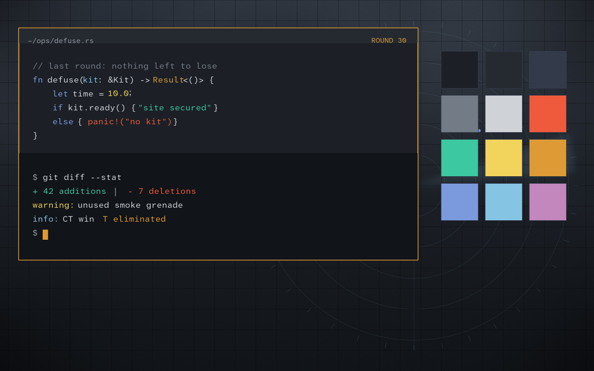
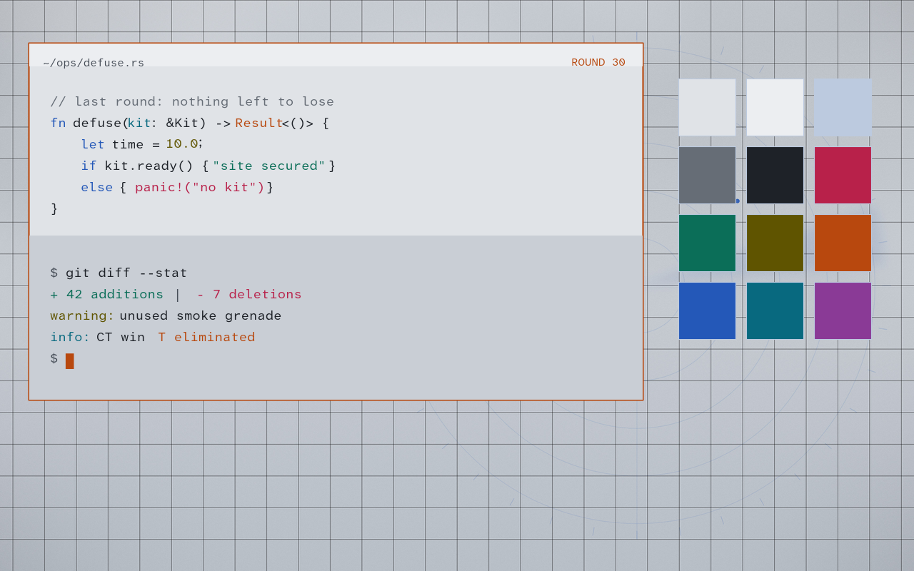
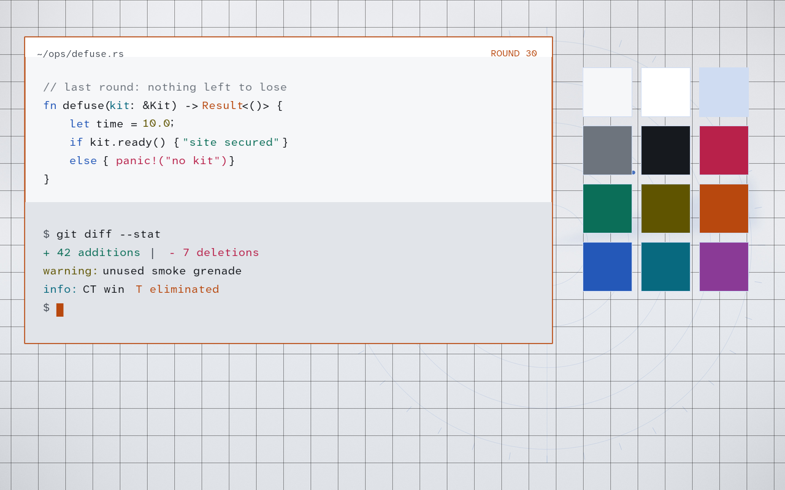

# Last Round

<svg xmlns="http://www.w3.org/2000/svg" viewBox="0 0 128 128" width="72" height="72" role="img" aria-label="Icon Last Round">
  <defs><linearGradient id="lrbg" x1="0" y1="0" x2="1" y2="1"><stop offset="0" stop-color="#181b20"/><stop offset="1" stop-color="#2a3140"/></linearGradient></defs>
  <rect width="128" height="128" rx="28" fill="url(#lrbg)"/>
  <g stroke="#de9b35" stroke-width="6" stroke-linecap="round"><line x1="64" y1="26" x2="64" y2="50"/><line x1="64" y1="78" x2="64" y2="102"/><line x1="26" y1="64" x2="50" y2="64"/><line x1="78" y1="64" x2="102" y2="64"/></g>
  <circle cx="64" cy="64" r="3.5" fill="#c5c9cf"/>
</svg>

Ein kühles, ruhiges Theme für Omarchy, gemacht für lange Sessions mit Code. Angelehnt an die Designsprache von Valve:
gedeckte Gunmetal-Flächen, nebelgrauer Text, ein einziger goldener Akzent und nichts, was sich mehr bewegt als nötig.


## Was es zeigt

- **Vier Helligkeitsstufen**
  - **Last Round** – dunkel, Gunmetal `#0f1114`, für die Nacht
  - **Dusk** – dunkel, Graphit `#1c2026`, abends, weniger Kontrast
  - **Overcast** – hell, flaches Grau `#e0e3e7`, wenig Blendung
  - **Daylight** – hell, fast weiß `#f6f7f9`, für helle Räume
- **Deutan-freundliche Palette** – Bedeutung hängt nie nur an Rot vs. Grün
  - Hauptachse ist Blau vs. Orange/Gold, das übersteht Rot-Grün-Schwäche
  - Fehler in Zinnoberrot, Hinzugefügtes in bläulichem Türkis – andere Farbe *und* Helligkeit
  - mit Deuteranopie-Simulation geprüft, Syntaxfarben mind. 4,5:1 Kontrast
- **Fadenkreuz-Cursor** – als Zeiger, golden gepunktet über Links; Textcursor und Pfeile bleiben normal
- **Fenster** – enge Abstände, 3-px-Ecken, dünner Goldrand am aktiven Fenster, der Rest leicht gedimmt
- **Bewegung** – kurz und knackig, ohne Nachschwingen
- **drei eigene Hintergründe** – Nebel über Raster, Radar, staubiger Horizont

| Dusk | Overcast | Daylight |
|---|---|---|
|  |  |  |

## Installieren

```bash
git clone https://github.com/vsvito420/omarchy-last-round.git
cd omarchy-last-round
./install.sh
omarchy theme set "Last Round"   # oder Dusk / Overcast / Daylight
```

Kopiert das Theme nach `~/.config/omarchy/themes`, baut den Cursor und legt einen kleinen Hook an – ohne sudo.
Entfernen mit `./install.sh --remove`.

Passende Schrift dazu (Omarchy setzt Schriften systemweit):

```bash
omarchy pkg add otf-atkinsonhyperlegiblemono-nerd
omarchy font set "AtkynsonMono Nerd Font Mono"
```

<div class="callout tip" markdown="1">
**Zu rund oder durchsichtig?** Eine eigene `~/.config/hypr/looknfeel.lua` lädt nach dem Theme und überschreibt es –
Rundung, Transparenz und Blur dort rausnehmen.
</div>

## So funktioniert's

- **Code:** [`themes/`](https://github.com/vsvito420/omarchy-last-round/tree/main/themes) – pro Variante `colors.toml`, `hyprland.lua`, Hintergründe und `preview.png`
- **Cursor:** `cursor/build.py` baut aus SVGs ein XCursor-Theme nach `~/.local/share/icons/LastRound-Crosshair`
- **Hook** `last-round-cursor` für `theme-set` und `post-boot` – schaltet den Cursor mit dem Theme an und wieder ab
- **Helle Varianten:** dunkles Gelb wirkt dort für deutane Augen wie Dunkelrot – daher Karminrot und Olivgold
- `install.sh` statt `omarchy theme install`, weil Omarchy bei Git-Themes `hyprland.lua` entfernt

## Siehe auch

- [[Omarchy]]
- [[Liquid Glass for Omarchy]], [[Fix my Scaling]]
