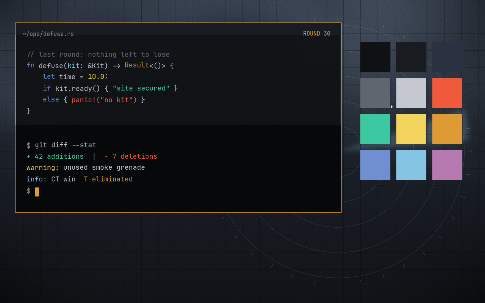

# Last Round for Omarchy

A tactical, cold and quiet theme for [Omarchy](https://omarchy.org), built for
long sessions of writing code. Inspired by Valve's design language: restrained
gunmetal surfaces, fog-grey text, a single gold accent, and nothing that moves
more than it needs to.



- **Deutan-friendly palette.** Meaning never rests on red vs green alone. The
  main signal axis is blue vs orange/gold, which survives red-green color
  blindness. Errors are a vermilion and additions a bluish teal, so they differ
  in hue *and* lightness. Every pair was checked with a deuteranopia simulation
  (Machado 2009), and all syntax colors reach at least 5.6:1 contrast on the
  background.
- **Crosshair cursor.** A classic four-line crosshair as the pointer and a gold
  dotted one over links and buttons. The text I-beam, resize arrows and busy
  cursor stay standard, so editing is not a guessing game. It switches on with
  the theme and back off when you pick another one.
- **Practical window chrome.** Tight gaps, 3px corners, a thin gold edge on the
  focused window, slight dimming of the rest. Windows stay fully opaque while
  focused, so no wallpaper bleeds through your code.
- **Quiet motion.** Short, snappy animations with no overshoot.
- **Smoked glass shell.** Light blur behind the bar, menus and notifications.
- **Three original wallpapers:** fog over a tactical grid, a dim radar, and a
  dust-orange horizon under a cold sky.
- Matching Chromium / Chrome toolbar color and a dark Yaru icon set.

## Install

```bash
git clone https://github.com/vsvito420/omarchy-last-round.git
cd omarchy-last-round
./install.sh
omarchy theme set "Last Round"
```

`install.sh` copies the theme into `~/.config/omarchy/themes`, builds the
cursor into `~/.local/share/icons/LastRound-Crosshair`, and installs one small
hook (`last-round-cursor`) for `theme-set` and `post-boot`. No sudo.

> **Why not `omarchy theme install <url>`?** For safety, Omarchy strips
> `hyprland.lua` from themes installed as git clones, and that file carries the
> window styling. Read it before installing: Hyprland executes it.

Remove everything again with `./install.sh --remove`.

> **Looks too round or see-through?** A custom `~/.config/hypr/looknfeel.lua`
> loads after the theme and overrides it. Remove rounding, opacity and blur
> settings from there to let the theme decide.

## Palette

| Role | Color | Role | Color |
| --- | --- | --- | --- |
| background | `#0f1114` | accent / orange | `#de9b35` |
| surface | `#181b20` | blue | `#6f8fd0` |
| selection | `#2a3140` | cyan | `#86c4e4` |
| muted | `#5f6670` | green (teal) | `#3cc8a0` |
| foreground | `#c5c9cf` | red (vermilion) | `#ef5a3c` |
| bright | `#f2f3f5` | yellow | `#f2d45c` |
| | | magenta | `#b67ab0` |

## Rebuilding the assets

```bash
tools/make-backgrounds.sh   # wallpapers (ImageMagick, fixed seeds)
tools/make-preview.py       # preview.png
cursor/build.py <dir>       # crosshair XCursor theme from the SVGs
```

## License

MIT
